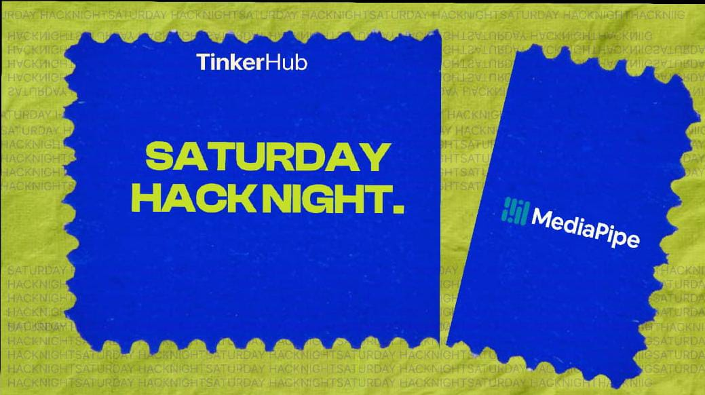

# SHN-MEDIAPIPE

#  Pixorra

### 💡 What's the idea?
Pixorra is a local tool for authoring and checking the JSON behind voxel-and-pixel games. Materials, reactions, spawn rules, regions, and quests are edited as visual node graphs and saved in the game’s own JSON files.

Its linter catches broken references, such as misspelled material IDs and out-of-range palette indices, before the game runs. It also flags orphaned materials, reaction cycles, and dead-end quest stages.

The tool is schema-driven. Saves preserve unchanged content byte-for-byte, and the core runs headlessly for scripts, CI, and seeded batch simulations.

### 🌐 Check it out!
- **Live Website:** [Drop your link here / N/A]
- **GitHub Repo:** https://github.com/Ashiqalink/SHN-MEDIAPIPE

### 🛠️ What did you use?
[Tech stack, tools, frameworks, libraries, etc.]

### 👥 The Humans Behind It
- Ashiq Ali N K

### ⚙️ Hardware Corner
[What hardware did you use? / N/A]

### 📸 Show Us What You Built!
[Add screenshots, photos, GIFs or demo video links here.]

### ✨ Cool Things It Does
- [Feature 1]
- [Feature 2]
- [Feature 3]

---

**Built with curiosity at Saturday Hack Night 💜**# 🚀 [Your Project Name]

### 💡 What's the idea?
[Tell us what you built and what it does. Keep it short!]

### 🌐 Check it out!
- **Live Website:** [Drop your link here / N/A]
- **GitHub Repo:** [Drop your repository link here]

### 🛠️ What did you use?
[Tech stack, tools, frameworks, libraries, etc.]

### 👥 The Humans Behind It
- [Name – GitHub Username]
- [Name – GitHub Username]

### ⚙️ Hardware Corner
[What hardware did you use? / N/A]

### 📸 Show Us What You Built!
[Add screenshots, photos, GIFs or demo video links here.]

### ✨ Cool Things It Does
- [Feature 1]
- [Feature 2]
- [Feature 3]

---

**Built with curiosity at Saturday Hack Night 💜**
